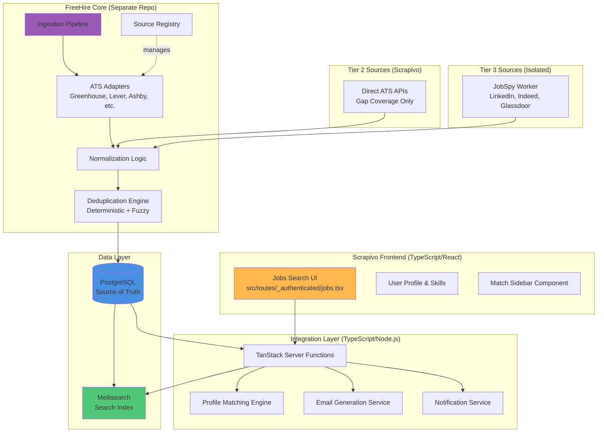
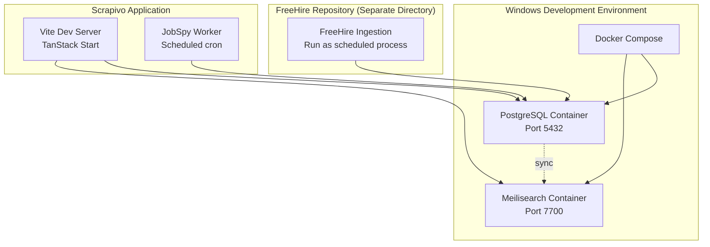
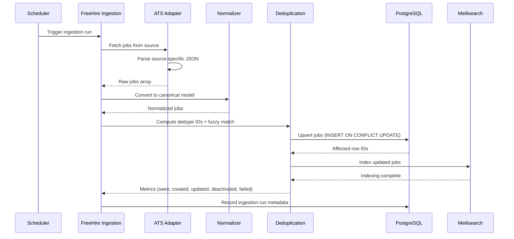
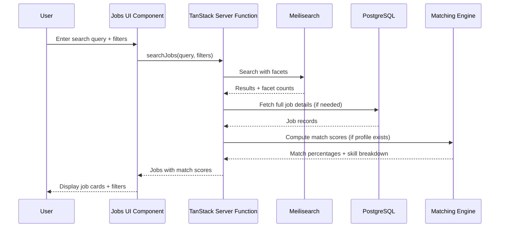

# Design Document: FreeHire Job Integration

## Overview

This design specifies the technical architecture for integrating the FreeHire job aggregation system (from strelov1/freehire GitHub repository) into the existing Scrapivo job finder application. The integration transforms Scrapivo from an in-memory, live-fetch architecture to a PostgreSQL-backed, Meilisearch-indexed job aggregation pipeline while preserving the existing frontend UI patterns and codebase structure.

### Design Philosophy: Extend, Do Not Rebuild

The integration follows a "reuse-first" principle: leverage FreeHire's proven ingestion pipeline, source registry, ATS adapters, PostgreSQL schema, normalization logic, deduplication algorithms, and Meilisearch configuration rather than building custom alternatives. This approach minimizes risk, reduces development time, and benefits from FreeHire's battle-tested implementation.

### Key Design Principles

1. **PostgreSQL as Single Source of Truth**: All job data is stored in PostgreSQL first; Meilisearch is a derived index that can be rebuilt at any time
2. **Phased Implementation**: Phase 1 validates FreeHire locally before integration; subsequent phases build on proven foundation
3. **Minimal Frontend Disruption**: Preserve existing Scrapivo UI components, routes, and user workflows
4. **Multi-Tier Source Strategy**: Prioritize FreeHire native sources (Tier 1), add direct ATS APIs only where gaps exist (Tier 2), isolate JobSpy integration (Tier 3)
5. **Observability First**: Every ingestion run tracks metrics (jobs seen, created, updated, deactivated, failed, errors) for operational visibility

### System Boundaries

**In Scope**:
- FreeHire repository deployment and verification (Phase 1)
- PostgreSQL and Meilisearch Docker Compose setup for Windows
- Canonical job model reconciliation between Scrapivo and FreeHire schemas
- Multi-tier source integration (FreeHire native + direct ATS APIs + JobSpy)
- Deterministic and fuzzy deduplication using rapidfuzz
- Profile matching with deterministic skill scoring and optional LLM-powered deep analysis
- Frontend integration with existing Scrapivo UI components
- Notification system for job alerts across multiple channels
- Ingestion pipeline reliability and observability
- Parser/serializer round-trip testing for data integrity

**Out of Scope**:
- Rebuilding FreeHire's ingestion architecture from scratch
- Building custom LinkedIn or Indeed scrapers (use JobSpy library)
- Manual onboarding of 300,000 companies
- Building a custom search engine (reuse Meilisearch)
- Separate standalone job portal
- Applicant Tracking System (ATS) features
- Recruiter CRM features
- Application tracker features
- Interview management features
- Kanban board for job applications

## Architecture

### High-Level System Architecture



### Architecture Layers

#### 1. Frontend Layer (Scrapivo UI)
- **Location**: `src/routes/_authenticated/jobs.tsx`, `src/components/jobs/`
- **Technology**: React 19.2.0, TypeScript, Tailwind CSS, shadcn/ui
- **Responsibility**: User interface for job search, filtering, detail view, match sidebar, bookmarking
- **Key Change**: Replace live-fetch calls with Meilisearch queries via TanStack server functions

#### 2. Integration Layer (Scrapivo Backend)
- **Location**: `src/lib/jobs/`, `src/lib/profile/`, new services in `src/lib/matching/` and `src/lib/notifications/`
- **Technology**: TypeScript/Node.js, TanStack Start server functions
- **Responsibility**: API endpoints, profile matching logic, email generation, notification dispatch
- **Key Components**:
  - Meilisearch query adapter (replaces in-memory filtering)
  - Profile matching engine (deterministic skill overlap + optional LLM analysis)
  - Email generation service (grounded in candidate profile data)
  - Notification service (Telegram, Discord, Email, Slack, WhatsApp)

#### 3. FreeHire Core (Separate Repository)
- **Location**: Cloned separately from `strelov1/freehire`, not forked
- **Technology**: (Assumed Python/Node.js based on typical job aggregators)
- **Responsibility**: Job fetching, normalization, deduplication, PostgreSQL storage, Meilisearch indexing
- **Key Components**:
  - **Ingestion Pipeline**: Orchestrates fetch, normalize, dedupe, store workflow
  - **Source Registry**: Central catalog of all job sources with metadata (ATS type, refresh interval, API details)
  - **ATS Adapters**: Source-specific parsers for Greenhouse, Lever, Ashby, iCIMS, Workday, SmartRecruiters, etc.
  - **Normalization Logic**: Converts source-specific schemas to Canonical Job Model
  - **Deduplication Engine**: Primary (deterministic) + secondary (fuzzy) matching

#### 4. Tier 2 Sources (Direct ATS APIs - Scrapivo)
- **Location**: `src/lib/jobs/tier2-adapters.ts` (new file)
- **Technology**: TypeScript/Node.js
- **Responsibility**: Direct API integrations for ATS platforms **only if FreeHire doesn't cover them**
- **Supported APIs**:
  - Greenhouse: `https://boards-api.greenhouse.io/v1/boards/{company}/jobs`
  - Lever: `https://api.lever.co/v0/postings/{company}?mode=json`
  - Ashby: `https://api.ashbyhq.com/posting-api/job-board/{company}`
  - SmartRecruiters: `https://api.smartrecruiters.com/v1/companies/{company}/postings` (with pagination)

#### 5. Tier 3 Sources (JobSpy Worker - Isolated)
- **Location**: `src/workers/jobspy-worker.ts` (new file)
- **Technology**: TypeScript wrapper around JobSpy Python library (via child process or microservice)
- **Responsibility**: Scheduled fetching from LinkedIn, Indeed, Glassdoor using JobSpy library
- **Isolation**: Runs as separate worker process, failures do not impact Tier 1/2 ingestion

#### 6. Data Layer
- **PostgreSQL**: Single source of truth for all job data, company data, ingestion run metadata
- **Meilisearch**: Derived search index for fast full-text search, faceted filtering, and sorting
- **Pattern**: Write to PostgreSQL first, then asynchronously index in Meilisearch (max 5 seconds delay)

### Deployment Architecture



### Data Flow: Job Ingestion



### Data Flow: Job Search



## Components and Interfaces

### Component 1: PostgreSQL Schema (FreeHire)

**Responsibility**: Store all job data, company data, source metadata, and ingestion run history

**Tables** (assumed from FreeHire repository, to be verified in Phase 1):

```sql
-- Jobs table (source of truth)
CREATE TABLE jobs (
    id UUID PRIMARY KEY DEFAULT gen_random_uuid(),
    source VARCHAR(100) NOT NULL, -- Primary source that created this record
    sources VARCHAR(100)[] NOT NULL DEFAULT ARRAY[]::VARCHAR[], -- All contributing sources
    source_job_id VARCHAR(255) NOT NULL, -- Original ID from source
    company_id UUID REFERENCES companies(id),
    company_name VARCHAR(500) NOT NULL,
    company_domain VARCHAR(255), -- For deduplication
    title VARCHAR(500) NOT NULL,
    description TEXT,
    url VARCHAR(1000) NOT NULL,
    location VARCHAR(500),
    cities VARCHAR(255)[],
    countries VARCHAR(100)[],
    regions VARCHAR(100)[],
    work_mode VARCHAR(50), -- remote, hybrid, onsite
    employment_type VARCHAR(50), -- full_time, part_time, contract, internship
    seniority VARCHAR(50), -- entry, mid, senior, staff, principal, executive
    role VARCHAR(100), -- engineer, designer, product, sales, etc.
    category VARCHAR(100), -- backend, frontend, devops, data, etc.
    skills VARCHAR(100)[],
    domains VARCHAR(100)[],
    company_type VARCHAR(50), -- startup, scaleup, enterprise, agency
    relocation BOOLEAN,
    english_level VARCHAR(50),
    salary_min INTEGER,
    salary_max INTEGER,
    salary_currency VARCHAR(10),
    posted_at TIMESTAMP,
    updated_at TIMESTAMP DEFAULT NOW(),
    expires_at TIMESTAMP,
    is_active BOOLEAN DEFAULT TRUE,
    created_at TIMESTAMP DEFAULT NOW(),
    dedupe_id VARCHAR(64) NOT NULL, -- SHA256(company_domain + normalized_title + normalized_location)
    UNIQUE(source, source_job_id)
);

CREATE INDEX idx_jobs_dedupe_id ON jobs(dedupe_id);
CREATE INDEX idx_jobs_is_active ON jobs(is_active);
CREATE INDEX idx_jobs_posted_at ON jobs(posted_at DESC);
CREATE INDEX idx_jobs_company_domain ON jobs(company_domain);

-- Companies table
CREATE TABLE companies (
    id UUID PRIMARY KEY DEFAULT gen_random_uuid(),
    name VARCHAR(500) NOT NULL,
    domain VARCHAR(255) UNIQUE,
    ats_type VARCHAR(50), -- greenhouse, lever, ashby, workday, etc.
    ats_board_id VARCHAR(255), -- Company identifier for ATS API
    created_at TIMESTAMP DEFAULT NOW(),
    updated_at TIMESTAMP DEFAULT NOW()
);

-- Ingestion runs table (observability)
CREATE TABLE ingestion_runs (
    id UUID PRIMARY KEY DEFAULT gen_random_uuid(),
    source VARCHAR(100) NOT NULL,
    started_at TIMESTAMP NOT NULL,
    completed_at TIMESTAMP,
    duration_ms INTEGER,
    jobs_seen INTEGER DEFAULT 0, -- Total fetched from source
    jobs_created INTEGER DEFAULT 0, -- New records inserted
    jobs_updated INTEGER DEFAULT 0, -- Existing records modified
    jobs_deactivated INTEGER DEFAULT 0, -- Marked inactive
    jobs_failed INTEGER DEFAULT 0, -- Processing errors
    errors JSONB, -- Array of error objects with messages and stack traces
    status VARCHAR(50) DEFAULT 'running' -- running, completed, failed
);

CREATE INDEX idx_ingestion_runs_source ON ingestion_runs(source);
CREATE INDEX idx_ingestion_runs_started_at ON ingestion_runs(started_at DESC);
```

**Schema Extension Strategy**:
1. Audit FreeHire's existing schema in Phase 1
2. Identify fields from Scrapivo's `JobPosting` type not present in FreeHire
3. Add missing fields via ALTER TABLE migrations only if necessary
4. Prefer mapping Scrapivo fields to existing FreeHire fields where semantically equivalent

### Component 2: Meilisearch Configuration

**Responsibility**: Provide fast full-text search, faceted filtering, and sorting for job queries

**Configuration** (reuse FreeHire's existing config):

```javascript
// Meilisearch index configuration
{
  "uid": "jobs",
  "primaryKey": "id",
  "searchableAttributes": [
    "title",
    "description",
    "company_name",
    "location",
    "cities",
    "countries",
    "skills",
    "domains",
    "role",
    "category"
  ],
  "filterableAttributes": [
    "collections",
    "regions",
    "work_mode",
    "role",
    "category",
    "ai_archetype",
    "seniority",
    "skills",
    "domains",
    "company_type",
    "countries",
    "cities",
    "relocation",
    "employment_type",
    "english_level",
    "salary_min",
    "salary_max",
    "salary_currency",
    "is_active"
  ],
  "sortableAttributes": [
    "posted_at",
    "updated_at",
    "salary_min",
    "salary_max"
  ],
  "rankingRules": [
    "words",
    "typo",
    "proximity",
    "attribute",
    "sort",
    "exactness"
  ],
  "stopWords": [],
  "synonyms": {
    "js": ["javascript"],
    "ts": ["typescript"],
    "py": ["python"],
    "golang": ["go"],
    "k8s": ["kubernetes"],
    "ai": ["artificial intelligence", "machine learning", "ml"]
  }
}
```

**Integration Strategy**:
- Reuse FreeHire's Meilisearch configuration without modification
- If additional facets are needed (e.g., match score ranges), extend `filterableAttributes`
- Sync strategy: PostgreSQL → Meilisearch within 5 seconds of job upsert

### Component 3: Canonical Job Data Model

**Responsibility**: Unified internal representation that all sources converge into

**TypeScript Interface** (reconciled from Scrapivo's `JobPosting` and FreeHire's schema):

```typescript
// src/lib/jobs/canonical-model.ts

/**
 * Canonical Job Model - unified representation for all job sources
 * This model reconciles Scrapivo's existing JobPosting type with FreeHire's PostgreSQL schema
 */
export interface CanonicalJob {
  // Identifiers
  id: string; // UUID from PostgreSQL
  source: string; // Primary source that created this record
  sources: string[]; // All contributing sources (for merged records)
  source_job_id: string; // Original ID from source system
  dedupe_id: string; // Deterministic hash for deduplication
  
  // Company
  company_id: string | null; // UUID reference to companies table
  company_name: string;
  company_domain: string | null; // Used for deduplication and company resolution
  company_type: string | null; // startup, scaleup, enterprise, agency
  
  // Job details
  title: string;
  description: string | null;
  url: string; // Application URL
  
  // Location
  location: string | null; // Original location string
  cities: string[];
  countries: string[];
  regions: string[];
  work_mode: 'remote' | 'hybrid' | 'onsite' | null;
  relocation: boolean;
  
  // Classification
  role: string | null; // engineer, designer, product, sales, etc.
  category: string | null; // backend, frontend, devops, data, etc.
  seniority: string | null; // entry, mid, senior, staff, principal, executive
  employment_type: string | null; // full_time, part_time, contract, internship
  
  // Skills and domains
  skills: string[]; // Technical skills (TypeScript, Python, AWS, etc.)
  domains: string[]; // Business domains (fintech, healthtech, ecommerce, etc.)
  
  // Requirements
  english_level: string | null; // native, fluent, professional, conversational
  
  // Compensation
  salary_min: number | null;
  salary_max: number | null;
  salary_currency: string | null;
  
  // Timestamps
  posted_at: Date | null;
  updated_at: Date;
  expires_at: Date | null;
  created_at: Date;
  
  // Status
  is_active: boolean;
  
  // Scrapivo-specific (computed, not stored in PostgreSQL)
  board_id?: string; // For backward compatibility with existing UI
  contacts?: Array<{ name?: string; title?: string; email?: string }>; // From contact enrichment
}

/**
 * Mapping from Scrapivo's existing JobPosting type to CanonicalJob
 */
export function mapScrapivoToCanonical(scrapivo: JobPosting): CanonicalJob {
  return {
    id: scrapivo.id,
    source: scrapivo.source,
    sources: [scrapivo.source],
    source_job_id: scrapivo.board_id,
    dedupe_id: scrapivo.id, // Will be recomputed by deduplication engine
    
    company_id: null,
    company_name: scrapivo.company,
    company_domain: scrapivo.company_domain || null,
    company_type: null,
    
    title: scrapivo.title,
    description: scrapivo.description,
    url: scrapivo.url,
    
    location: scrapivo.location,
    cities: [],
    countries: [],
    regions: [],
    work_mode: scrapivo.remote ? 'remote' : null,
    relocation: false,
    
    role: null,
    category: null,
    seniority: scrapivo.seniority,
    employment_type: null,
    
    skills: [],
    domains: [],
    
    english_level: null,
    
    salary_min: scrapivo.salary ? parseSalaryMin(scrapivo.salary) : null,
    salary_max: scrapivo.salary ? parseSalaryMax(scrapivo.salary) : null,
    salary_currency: scrapivo.salary ? parseSalaryCurrency(scrapivo.salary) : null,
    
    posted_at: scrapivo.posted_at ? new Date(scrapivo.posted_at) : null,
    updated_at: new Date(),
    expires_at: null,
    created_at: new Date(),
    
    is_active: true,
    
    board_id: scrapivo.board_id,
    contacts: scrapivo.contacts
  };
}

// Helper functions for salary parsing
function parseSalaryMin(salary: string): number | null {
  // Implementation depends on salary format in existing Scrapivo data
  const match = salary.match(/\$?(\d[\d,]*)/);
  return match ? parseInt(match[1].replace(/,/g, ''), 10) : null;
}

function parseSalaryMax(salary: string): number | null {
  const matches = salary.match(/\$?(\d[\d,]*)/g);
  return matches && matches.length > 1
    ? parseInt(matches[1].replace(/[$,]/g, ''), 10)
    : null;
}

function parseSalaryCurrency(salary: string): string | null {
  if (salary.includes('$')) return 'USD';
  if (salary.includes('€')) return 'EUR';
  if (salary.includes('£')) return 'GBP';
  return 'USD'; // Default assumption
}
```

### Component 4: Deduplication Engine

**Responsibility**: Identify and merge duplicate job postings from multiple sources

**Algorithm**:

1. **Primary (Deterministic) Deduplication**:
   - Compute `dedupe_id = SHA256(normalized_company_domain + normalized_title + normalized_location)`
   - Normalization rules:
     - Company domain: lowercase, remove `www.`, extract root domain
     - Title: lowercase, remove punctuation, collapse whitespace, remove common suffixes ("- Remote", "- London", etc.)
     - Location: lowercase, map city aliases ("SF" → "San Francisco"), extract city name only
   - If `dedupe_id` matches existing record, merge sources array and update record

2. **Secondary (Fuzzy) Deduplication**:
   - For jobs with same `company_domain` but different `dedupe_id`, compute fuzzy match score
   - Use `rapidfuzz` library with `token_sort_ratio` scorer
   - Similarity score formula: `score = (title_similarity * 0.6 + location_similarity * 0.4)`
   - If `score >= 0.85`, merge records
   - Preserve earliest `posted_at` and latest `updated_at` when merging

3. **Merge Strategy**:
   - Primary source: Prefer ATS sources over third-party boards (Greenhouse > Indeed)
   - URL selection: Always prefer direct ATS URL over aggregator URL
   - Field merging:
     - `sources`: Union of all contributing sources
     - `skills`, `domains`: Union of all extracted skills/domains
     - `description`: Keep longest non-null description
     - `salary_min/max`: Keep highest validated range

**Implementation** (reuse FreeHire's existing deduplication logic):

```typescript
// src/lib/jobs/deduplication.ts

import { createHash } from 'node:crypto';
import { token_sort_ratio } from 'rapidfuzz';

export interface DedupeInput {
  company_domain: string | null;
  title: string;
  location: string | null;
}

/**
 * Compute deterministic dedupe ID for primary matching
 */
export function computeDedupeId(input: DedupeInput): string {
  const domain = normalizeDomain(input.company_domain);
  const title = normalizeTitle(input.title);
  const location = normalizeLocation(input.location);
  
  const key = `${domain}|${title}|${location}`;
  return createHash('sha256').update(key).digest('hex');
}

function normalizeDomain(domain: string | null): string {
  if (!domain) return 'unknown';
  return domain
    .toLowerCase()
    .replace(/^www\./, '')
    .replace(/\/$/, '')
    .split('.')[0]; // Extract root domain only
}

function normalizeTitle(title: string): string {
  return title
    .toLowerCase()
    .replace(/[^\w\s]/g, '') // Remove punctuation
    .replace(/\b(remote|hybrid|onsite)\b/gi, '') // Remove work mode suffixes
    .replace(/\b(entry|junior|mid|senior|staff|principal|lead)\b/gi, '') // Remove seniority
    .replace(/\s+/g, ' ') // Collapse whitespace
    .trim();
}

function normalizeLocation(location: string | null): string {
  if (!location) return 'unknown';
  
  // Map city aliases
  const aliases: Record<string, string> = {
    'sf': 'san francisco',
    'nyc': 'new york',
    'la': 'los angeles',
  };
  
  let normalized = location.toLowerCase();
  for (const [alias, full] of Object.entries(aliases)) {
    normalized = normalized.replace(new RegExp(`\\b${alias}\\b`, 'g'), full);
  }
  
  // Extract city name only (before comma if present)
  const city = normalized.split(',')[0].trim();
  return city;
}

/**
 * Compute fuzzy match score between two jobs (same company_domain, different dedupe_id)
 */
export function fuzzyMatchScore(job1: DedupeInput, job2: DedupeInput): number {
  const titleScore = token_sort_ratio(
    normalizeTitle(job1.title),
    normalizeTitle(job2.title)
  ) / 100;
  
  const locationScore = token_sort_ratio(
    normalizeLocation(job1.location),
    normalizeLocation(job2.location)
  ) / 100;
  
  return titleScore * 0.6 + locationScore * 0.4;
}

/**
 * Determine if two jobs should be merged based on fuzzy matching
 */
export function shouldMerge(job1: DedupeInput, job2: DedupeInput): boolean {
  // Only fuzzy match jobs from same company
  if (normalizeDomain(job1.company_domain) !== normalizeDomain(job2.company_domain)) {
    return false;
  }
  
  const score = fuzzyMatchScore(job1, job2);
  return score >= 0.85;
}
```

### Component 5: Profile Matching Engine

**Responsibility**: Compute match scores between candidate profiles and job requirements

**Deterministic Matching** (no LLM required):

```typescript
// src/lib/matching/deterministic-matcher.ts

export interface UserProfile {
  skills: string[]; // e.g., ["TypeScript", "React", "Node.js", "PostgreSQL"]
  experience_years: number;
  seniority: string | null;
}

export interface MatchResult {
  match_percentage: number; // 0-100
  skills_have: string[]; // Skills present in both profile and job
  skills_close: string[]; // Skills related via synonyms/taxonomy
  skills_missing: string[]; // Required skills not in profile
}

// Skill synonym mappings (extensible)
const SKILL_SYNONYMS: Record<string, string[]> = {
  'javascript': ['js', 'ecmascript', 'es6'],
  'typescript': ['ts'],
  'python': ['py'],
  'kubernetes': ['k8s'],
  'react': ['reactjs', 'react.js'],
  'node.js': ['nodejs', 'node'],
  'postgresql': ['postgres', 'psql'],
};

/**
 * Compute deterministic match score based on skill overlap
 */
export function computeMatch(profile: UserProfile, job: CanonicalJob): MatchResult {
  const required_skills = job.skills || [];
  const user_skills = profile.skills.map(s => s.toLowerCase());
  
  const skills_have: string[] = [];
  const skills_close: string[] = [];
  const skills_missing: string[] = [];
  
  for (const req of required_skills) {
    const req_lower = req.toLowerCase();
    
    // Exact match
    if (user_skills.includes(req_lower)) {
      skills_have.push(req);
      continue;
    }
    
    // Synonym match
    const synonyms = getSynonyms(req_lower);
    const hasSynonym = user_skills.some(skill => synonyms.includes(skill));
    if (hasSynonym) {
      skills_close.push(req);
      continue;
    }
    
    // No match
    skills_missing.push(req);
  }
  
  const total_required = required_skills.length || 1; // Avoid division by zero
  const match_percentage = Math.round(
    ((skills_have.length + skills_close.length * 0.5) / total_required) * 100
  );
  
  return {
    match_percentage: Math.min(match_percentage, 100),
    skills_have,
    skills_close,
    skills_missing
  };
}

function getSynonyms(skill: string): string[] {
  const synonyms = SKILL_SYNONYMS[skill] || [];
  return [skill, ...synonyms];
}
```

**Deep Analysis (Optional LLM-Powered)**:

```typescript
// src/lib/matching/deep-matcher.ts

export interface DeepMatchResult {
  compatibility_score: number; // 0-100
  reasoning: string; // LLM-generated explanation
  strengths: string[]; // Candidate's relevant strengths
  gaps: string[]; // Areas where candidate doesn't match
  recommendations: string[]; // Suggestions for candidate
}

/**
 * Compute deep match analysis using LLM
 * This is rate-limited and cached per (profile_id, job_id) pair
 */
export async function computeDeepMatch(
  profile: UserProfile,
  job: CanonicalJob,
  options: { force?: boolean } = {}
): Promise<DeepMatchResult> {
  // Check cache first
  const cacheKey = `deep_match:${profile.id}:${job.id}`;
  if (!options.force) {
    const cached = await getCachedMatch(cacheKey);
    if (cached) return cached;
  }
  
  // Check user quota
  const quotaRemaining = await checkUserQuota(profile.user_id);
  if (quotaRemaining <= 0) {
    throw new Error('Monthly deep match analysis quota exhausted');
  }
  
  // Construct LLM prompt
  const prompt = `
Analyze the compatibility between this candidate profile and job posting.

CANDIDATE PROFILE:
- Skills: ${profile.skills.join(', ')}
- Experience: ${profile.experience_years} years
- Seniority: ${profile.seniority || 'Not specified'}
${profile.bio ? `- Bio: ${profile.bio}` : ''}

JOB POSTING:
- Title: ${job.title}
- Company: ${job.company_name}
- Required Skills: ${job.skills.join(', ')}
- Seniority: ${job.seniority || 'Not specified'}
- Description: ${job.description?.substring(0, 500)}...

Provide:
1. Compatibility score (0-100)
2. Specific examples from candidate's profile that match job requirements
3. Key gaps where candidate doesn't match
4. Recommendations for candidate

Format as JSON.
`.trim();
  
  // Call LLM (implementation depends on LLM provider)
  const llmResponse = await callLLM(prompt);
  const result = parseLLMResponse(llmResponse);
  
  // Cache result
  await cacheMatch(cacheKey, result, { ttl: 86400 * 30 }); // 30 days
  
  // Decrement quota
  await decrementUserQuota(profile.user_id);
  
  return result;
}

// Placeholder implementations (actual implementation depends on LLM provider and caching strategy)
async function getCachedMatch(key: string): Promise<DeepMatchResult | null> {
  // Redis or in-memory cache lookup
  return null;
}

async function checkUserQuota(userId: string): Promise<number> {
  // Query user's remaining monthly quota
  return 50; // Default quota
}

async function callLLM(prompt: string): Promise<string> {
  // Call OpenAI/Anthropic/Groq API
  return '';
}

function parseLLMResponse(response: string): DeepMatchResult {
  // Parse JSON response from LLM
  return {
    compatibility_score: 0,
    reasoning: '',
    strengths: [],
    gaps: [],
    recommendations: []
  };
}

async function cacheMatch(key: string, result: DeepMatchResult, options: { ttl: number }): Promise<void> {
  // Store in cache with TTL
}

async function decrementUserQuota(userId: string): Promise<void> {
  // Decrement monthly quota counter
}
```

### Component 6: Meilisearch Query Adapter

**Responsibility**: Translate Scrapivo's existing `JobSearchFilters` into Meilisearch queries

```typescript
// src/lib/jobs/meilisearch-adapter.ts

import { MeiliSearch, type SearchResponse } from 'meilisearch';
import type { JobSearchFilters, CanonicalJob } from './types';

const client = new MeiliSearch({
  host: process.env.MEILISEARCH_HOST || 'http://localhost:7700',
  apiKey: process.env.MEILISEARCH_MASTER_KEY || ''
});

export interface JobSearchResult {
  jobs: CanonicalJob[];
  total: number;
  facets: Record<string, Record<string, number>>;
  page: number;
  pageSize: number;
}

/**
 * Search jobs using Meilisearch (replaces in-memory filtering)
 */
export async function searchJobs(filters: JobSearchFilters): Promise<JobSearchResult> {
  const index = client.index('jobs');
  
  const meilisearchQuery = {
    q: filters.query || '',
    filter: buildFilterString(filters),
    facets: [
      'work_mode',
      'seniority',
      'employment_type',
      'countries',
      'regions',
      'company_type',
      'role',
      'category'
    ],
    sort: ['posted_at:desc'],
    limit: filters.limit || 50,
    offset: 0
  };
  
  const response: SearchResponse<CanonicalJob> = await index.search(
    meilisearchQuery.q,
    {
      filter: meilisearchQuery.filter,
      facets: meilisearchQuery.facets,
      sort: meilisearchQuery.sort,
      limit: meilisearchQuery.limit,
      offset: meilisearchQuery.offset
    }
  );
  
  return {
    jobs: response.hits,
    total: response.estimatedTotalHits || 0,
    facets: response.facetDistribution || {},
    page: 1,
    pageSize: meilisearchQuery.limit
  };
}

/**
 * Build Meilisearch filter string from Scrapivo filters
 */
function buildFilterString(filters: JobSearchFilters): string {
  const conditions: string[] = [];
  
  // Always filter for active jobs
  conditions.push('is_active = true');
  
  // Location filter
  if (filters.location) {
    conditions.push(`(location = "${filters.location}" OR cities = "${filters.location}" OR countries = "${filters.location}")`);
  }
  
  // Remote-only filter
  if (filters.remoteOnly) {
    conditions.push('work_mode = "remote"');
  }
  
  // Seniority filter
  if (filters.seniority) {
    conditions.push(`seniority = "${filters.seniority}"`);
  }
  
  // Region filter (maps Scrapivo's JobRegion to FreeHire's regions array)
  if (filters.region && filters.region !== 'any') {
    const regionMap: Record<string, string> = {
      'remote': 'remote',
      'north_america': 'North America',
      'europe': 'Europe',
      'asia': 'Asia',
      'middle_east': 'Middle East'
    };
    const mappedRegion = regionMap[filters.region];
    if (mappedRegion) {
      conditions.push(`regions = "${mappedRegion}"`);
    }
  }
  
  // Source filter (maps Scrapivo's sources to FreeHire's sources array)
  if (filters.sources && filters.sources.length > 0) {
    const sourceConditions = filters.sources.map(s => `sources = "${s}"`);
    conditions.push(`(${sourceConditions.join(' OR ')})`);
  }
  
  // Contact roles filter (if searching for jobs with specific contact roles)
  if (filters.contactRoles && filters.contactRoles.length > 0) {
    // This requires enriching jobs with contact data, which is out of initial scope
    // Placeholder for future implementation
  }
  
  return conditions.join(' AND ');
}

/**
 * Get job by ID from Meilisearch (faster than PostgreSQL for single lookups)
 */
export async function getJobById(id: string): Promise<CanonicalJob | null> {
  try {
    const index = client.index('jobs');
    const job = await index.getDocument<CanonicalJob>(id);
    return job;
  } catch (error) {
    console.error(`Job ${id} not found in Meilisearch:`, error);
    return null;
  }
}
```

## Data Models

### Canonical Job Model

See **Component 3: Canonical Job Data Model** section above for complete TypeScript interface and mapping logic.

**Key Fields**:
- **Identity**: `id`, `source`, `sources`, `source_job_id`, `dedupe_id`
- **Company**: `company_id`, `company_name`, `company_domain`, `company_type`
- **Content**: `title`, `description`, `url`
- **Location**: `location`, `cities`, `countries`, `regions`, `work_mode`, `relocation`
- **Classification**: `role`, `category`, `seniority`, `employment_type`
- **Skills**: `skills`, `domains`, `english_level`
- **Compensation**: `salary_min`, `salary_max`, `salary_currency`
- **Timestamps**: `posted_at`, `updated_at`, `expires_at`, `created_at`
- **Status**: `is_active`

### User Profile Model

```typescript
// src/lib/profile/types.ts

export interface UserProfile {
  id: string;
  user_id: string; // Reference to auth user
  
  // Basic info
  full_name: string;
  email: string;
  bio: string | null;
  
  // Skills and experience
  skills: string[]; // Technical skills
  experience_years: number;
  seniority: string | null; // entry, mid, senior, staff, principal
  
  // Preferences
  desired_roles: string[]; // backend, frontend, fullstack, etc.
  desired_work_mode: string | null; // remote, hybrid, onsite
  desired_locations: string[]; // Preferred cities/countries
  salary_min: number | null;
  salary_currency: string | null;
  
  // Notification preferences
  notification_channels: NotificationChannel[];
  notification_frequency: 'realtime' | 'daily' | 'weekly';
  
  // Quotas
  deep_match_quota_used: number; // Incremented with each deep analysis
  deep_match_quota_limit: number; // Monthly limit
  quota_reset_at: Date; // Next reset date
  
  // Timestamps
  created_at: Date;
  updated_at: Date;
}

export interface NotificationChannel {
  type: 'telegram' | 'discord' | 'email' | 'slack' | 'whatsapp';
  enabled: boolean;
  config: Record<string, any>; // Channel-specific config (bot token, webhook URL, etc.)
}
```

### Ingestion Run Metadata

```typescript
// src/lib/jobs/ingestion-types.ts

export interface IngestionRun {
  id: string;
  source: string; // Source identifier (e.g., "greenhouse", "lever", "jobspy-linkedin")
  
  // Timing
  started_at: Date;
  completed_at: Date | null;
  duration_ms: number | null;
  
  // Metrics
  jobs_seen: number; // Total fetched from source
  jobs_created: number; // New records inserted
  jobs_updated: number; // Existing records modified
  jobs_deactivated: number; // Marked inactive
  jobs_failed: number; // Processing errors
  
  // Errors
  errors: IngestionError[];
  
  // Status
  status: 'running' | 'completed' | 'failed';
}

export interface IngestionError {
  job_url: string | null;
  error_type: string; // parse_error, network_error, validation_error, etc.
  message: string;
  stack_trace: string | null;
  timestamp: Date;
}
```


## Correctness Properties

*A property is a characteristic or behavior that should hold true across all valid executions of a system—essentially, a formal statement about what the system should do. Properties serve as the bridge between human-readable specifications and machine-verifiable correctness guarantees.*

### Property 1: Job Normalization Preserves Required Fields

*For any* valid raw job data from any source, normalizing it into the Canonical_Job_Model SHALL produce a valid canonical job with all required fields (id, source, company_name, title, url, is_active, created_at, updated_at) populated with non-null values.

**Validates: Requirements 2.2, 2.3, 3.2**

### Property 2: Ingestion Metrics Internal Consistency

*For any* completed ingestion run, the sum of (jobs_created + jobs_updated + jobs_failed) SHALL equal jobs_seen, and all metric fields (started_at, completed_at, duration, jobs_seen, jobs_created, jobs_updated, jobs_deactivated, jobs_failed) SHALL be present with valid values.

**Validates: Requirements 2.5, 8.1, 8.2**

### Property 3: Ingestion Idempotence

*For any* set of job data, running the ingestion pipeline twice with the same input SHALL NOT create duplicate records; the second run should only update existing records as indicated by jobs_updated metric.

**Validates: Requirements 2.7**

### Property 4: Source Provenance Preservation on Merge

*For any* set of duplicate jobs from different sources, merging them SHALL preserve all contributing source identifiers in the sources array field.

**Validates: Requirements 3.6, 4.2**

### Property 5: Deterministic Deduplication ID

*For any* two jobs with the same normalized company_domain, normalized_title, and normalized_location, the computed dedupe_id SHALL be identical.

**Validates: Requirements 4.1**

### Property 6: Fuzzy Matching Threshold

*For any* pair of jobs from the same company with fuzzy similarity score >= 0.85, the deduplication engine SHALL merge them into a single record.

**Validates: Requirements 4.3, 4.4**

### Property 7: Historical Record Preservation

*For any* job marked inactive (is_active = false), the corresponding database record SHALL still exist and be retrievable by ID.

**Validates: Requirements 4.5**

### Property 8: Deactivation Timestamp Recording

*For any* active job that transitions to inactive status, the system SHALL record a deactivation timestamp in the updated_at field and set is_active to false.

**Validates: Requirements 4.6**

### Property 9: Merge Timestamp Preservation

*For any* set of duplicate jobs being merged, the merged record SHALL have posted_at equal to the earliest posted_at value and updated_at equal to the latest updated_at value among all input jobs.

**Validates: Requirements 4.7**

### Property 10: Error Isolation in Multi-Source Ingestion

*For any* ingestion run where one source fails, all other sources SHALL continue processing successfully, and the ingestion_run metadata SHALL reflect the failure in the errors field and jobs_failed count.

**Validates: Requirements 5.10**

### Property 11: PostgreSQL-First Write Ordering

*For any* job ingestion operation, the job record SHALL be written to PostgreSQL and committed before any Meilisearch indexing operation begins.

**Validates: Requirements 6.1, 6.2**

### Property 12: Meilisearch Index Rebuild Completeness

*For any* Meilisearch index rebuild operation, the rebuilt index SHALL contain all and only the active jobs (is_active = true) present in PostgreSQL at the time of rebuild initiation.

**Validates: Requirements 6.3**

### Property 13: Search Facet Completeness

*For any* search query, the returned response SHALL include facet aggregations for all configured facet fields (work_mode, seniority, employment_type, countries, regions, company_type) with live counts.

**Validates: Requirements 7.5, 7.7**

### Property 14: Pagination Boundary Handling

*For any* valid page size N (where 10 <= N <= 100), requesting page P SHALL return at most N results, and the union of all pages SHALL equal the complete result set with no duplicates or missing records.

**Validates: Requirements 7.6**

### Property 15: Error Capture on Ingestion Failure

*For any* job that fails to process during ingestion, the ingestion_run metadata SHALL capture error details including error message, error type, and job URL in the errors array field.

**Validates: Requirements 8.8**

### Property 16: Stale Job Auto-Deactivation

*For any* job with posted_at or updated_at older than its source's refresh interval, the system SHALL automatically mark it inactive (is_active = false) during the next ingestion run for that source.

**Validates: Requirements 8.10**

### Property 17: Deterministic Match Score Computation

*For any* user profile and job posting, computing the match percentage SHALL produce the same score on repeated invocations with the same inputs, and the score SHALL be in the range [0, 100].

**Validates: Requirements 9.1**

### Property 18: Skills Have Computation

*For any* user profile with skills set S and job posting with required skills set R, skills_have SHALL equal the intersection S ∩ R (exact matches only, case-insensitive).

**Validates: Requirements 9.2**

### Property 19: Skills Close Computation

*For any* user profile with skills set S and job posting with required skills set R, skills_close SHALL include all skills from R that have a synonym match in S but are not in skills_have.

**Validates: Requirements 9.3**

### Property 20: Skills Missing Computation

*For any* user profile with skills set S and job posting with required skills set R, skills_missing SHALL equal R - (skills_have ∪ skills_close).

**Validates: Requirements 9.4**

### Property 21: Match Percentage Formula

*For any* match computation result with counts h (skills_have), c (skills_close), and r (total_required_skills where r > 0), the match_percentage SHALL equal ⌊((h + 0.5 * c) / r) * 100⌋ clamped to [0, 100].

**Validates: Requirements 9.5**

### Property 22: Deep Match Cache Hit

*For any* user profile and job combination with an existing cached deep match result, subsequent requests SHALL return the cached result without invoking the LLM.

**Validates: Requirements 10.3, 10.4**

### Property 23: Deep Match Quota Enforcement

*For any* user whose deep_match_quota_used >= deep_match_quota_limit, further deep match analysis requests SHALL be rejected with a quota exhaustion error until the quota resets.

**Validates: Requirements 10.5**

### Property 24: Bookmark Persistence Round-Trip

*For any* user and job, if the user bookmarks the job, then querying the user's bookmarks SHALL include that job, and unbookmarking SHALL remove it from the query results.

**Validates: Requirements 12.6**

### Property 25: ATS Parser Round-Trip (Greenhouse)

*For any* valid Canonical_Job_Model instance derived from a Greenhouse API response, serializing it to JSON and then parsing the JSON SHALL produce an equivalent canonical job object (round-trip property).

**Validates: Requirements 14.1, 14.6, 14.7**

### Property 26: ATS Parser Round-Trip (Lever)

*For any* valid Canonical_Job_Model instance derived from a Lever API response, serializing it to JSON and then parsing the JSON SHALL produce an equivalent canonical job object (round-trip property).

**Validates: Requirements 14.2, 14.6, 14.7**

### Property 27: ATS Parser Round-Trip (Ashby)

*For any* valid Canonical_Job_Model instance derived from an Ashby API response, serializing it to JSON and then parsing the JSON SHALL produce an equivalent canonical job object (round-trip property).

**Validates: Requirements 14.3, 14.6, 14.7**

### Property 28: ATS Parser Round-Trip (SmartRecruiters)

*For any* valid Canonical_Job_Model instance derived from a SmartRecruiters API response, serializing it to JSON and then parsing the JSON SHALL produce an equivalent canonical job object (round-trip property).

**Validates: Requirements 14.4, 14.6, 14.7**

### Property 29: Parser Error Descriptiveness

*For any* invalid job data that fails to parse, the parsing function SHALL return an error object containing the source identifier and a descriptive error message indicating the nature of the failure.

**Validates: Requirements 14.5**

### Property 30: Notification Content Completeness

*For any* job match notification sent to a user, the notification content SHALL include the job title, company name, location, match percentage, and a valid direct link to the job detail page.

**Validates: Requirements 15.2, 15.3**

### Property 31: Notification Rate Limiting

*For any* user, if more than 10 notifications have been sent within the past hour, additional notification send attempts SHALL be blocked until the hourly window slides.

**Validates: Requirements 15.4**

### Property 32: Notification Channel Disable

*For any* user who disables a notification channel, subsequent matching jobs SHALL NOT trigger notifications to that channel until it is re-enabled.

**Validates: Requirements 15.5**

### Property 33: Notification Retry with Exponential Backoff

*For any* notification that fails to deliver, the system SHALL retry up to 3 times with exponential backoff delays (e.g., 1s, 2s, 4s), and log all failures.

**Validates: Requirements 15.6**

### Property 34: Data Retention Policy

*For any* job marked inactive, the record SHALL remain in the PostgreSQL database for exactly 90 days before being archived to a separate archive table.

**Validates: Requirements 20.1, 20.2**

### Property 35: PII Exclusion from Plain Text Storage

*For any* job record stored in PostgreSQL, the description and other text fields SHALL NOT contain personally identifiable information (email addresses, phone numbers, social security numbers) in plain text.

**Validates: Requirements 20.3**

### Property 36: Profile Encryption at Rest

*For any* user profile stored in the database, sensitive fields (email, contact details, API keys if applicable) SHALL be encrypted using a secure encryption algorithm.

**Validates: Requirements 20.4**

### Property 37: Data Export Completeness

*For any* user requesting data export, the exported data SHALL include all profile data, search history, bookmarks, and notification history associated with that user account.

**Validates: Requirements 20.6**

### Property 38: Account Deletion Completeness

*For any* user requesting account deletion, all associated data (profile, search history, bookmarks, notification preferences, cached match results) SHALL be removed from the system within 30 days.

**Validates: Requirements 20.7**

## Error Handling

### Error Categories

The system identifies and handles the following error categories:

1. **Ingestion Errors**:
   - **Network Errors**: Source API unavailable, timeout, connection refused
   - **Parse Errors**: Invalid JSON, missing required fields, schema mismatch
   - **Validation Errors**: Data fails business logic validation (e.g., invalid URL format)
   - **Database Errors**: PostgreSQL connection failure, constraint violation, deadlock

2. **Search Errors**:
   - **Meilisearch Unavailable**: Search index not reachable
   - **Invalid Query**: Malformed search query or filter syntax
   - **Timeout**: Query exceeds maximum execution time

3. **Profile Matching Errors**:
   - **Missing Profile**: User has no profile configured
   - **LLM Errors**: API rate limit exceeded, invalid response, timeout
   - **Quota Exceeded**: User has exhausted monthly deep match quota

4. **Notification Errors**:
   - **Channel Unavailable**: Telegram bot token invalid, Discord webhook dead
   - **Rate Limit**: Too many notifications sent in time window
   - **Delivery Failure**: Message rejected by external service

### Error Handling Strategy

**Ingestion Pipeline**:
```typescript
// src/lib/jobs/ingestion-error-handler.ts

export async function handleIngestionError(
  error: Error,
  context: {
    source: string;
    jobUrl?: string;
    runId: string;
  }
): Promise<void> {
  // Classify error
  const errorType = classifyError(error);
  
  // Log error with full context
  console.error(`[Ingestion Error] ${context.source}:`, {
    type: errorType,
    message: error.message,
    stack: error.stack,
    jobUrl: context.jobUrl,
    runId: context.runId
  });
  
  // Record error in ingestion_runs table
  await recordIngestionError({
    run_id: context.runId,
    error_type: errorType,
    message: error.message,
    stack_trace: error.stack || null,
    job_url: context.jobUrl || null,
    timestamp: new Date()
  });
  
  // Increment failure metric
  await incrementFailureCount(context.runId);
  
  // Do NOT throw - allow other sources to continue processing
}

function classifyError(error: Error): string {
  if (error.message.includes('ECONNREFUSED') || error.message.includes('ETIMEDOUT')) {
    return 'network_error';
  }
  if (error.message.includes('JSON') || error.message.includes('parse')) {
    return 'parse_error';
  }
  if (error.message.includes('validation')) {
    return 'validation_error';
  }
  if (error.message.includes('PostgreSQL') || error.message.includes('database')) {
    return 'database_error';
  }
  return 'unknown_error';
}
```

**Search Query Error Handling**:
```typescript
// src/lib/jobs/search-error-handler.ts

export async function handleSearchError(error: Error): Promise<JobSearchResult> {
  console.error('[Search Error]:', error);
  
  // If Meilisearch is unavailable, fall back to PostgreSQL direct query
  if (error.message.includes('Meilisearch') || error.message.includes('ECONNREFUSED')) {
    console.warn('Meilisearch unavailable, falling back to PostgreSQL');
    return await searchJobsFromPostgres(); // Slower, but ensures availability
  }
  
  // If query is malformed, return empty result set with error message
  if (error.message.includes('invalid') || error.message.includes('syntax')) {
    return {
      jobs: [],
      total: 0,
      facets: {},
      page: 1,
      pageSize: 50,
      error: 'Invalid search query. Please check your filters and try again.'
    };
  }
  
  // For all other errors, return empty result set with generic error
  return {
    jobs: [],
    total: 0,
    facets: {},
    page: 1,
    pageSize: 50,
    error: 'Search service temporarily unavailable. Please try again in a moment.'
  };
}
```

**Profile Matching Error Handling**:
```typescript
// src/lib/matching/match-error-handler.ts

export async function handleMatchError(
  error: Error,
  context: { userId: string; jobId: string }
): Promise<MatchResult | null> {
  console.error('[Match Error]:', error, context);
  
  // If deep match quota exceeded, return friendly error
  if (error.message.includes('quota')) {
    throw new Error('You have reached your monthly limit for deep match analysis. Your quota will reset on [reset_date].');
  }
  
  // If LLM service unavailable, return deterministic match only
  if (error.message.includes('LLM') || error.message.includes('API')) {
    console.warn('LLM service unavailable, returning deterministic match only');
    // Deterministic matching still works without LLM
    return null; // Caller will handle by showing only basic match
  }
  
  // For missing profile, return helpful error
  if (error.message.includes('profile')) {
    throw new Error('Please complete your profile to see match scores.');
  }
  
  // Generic error
  throw new Error('Unable to compute match score. Please try again later.');
}
```

**Notification Error Handling**:
```typescript
// src/lib/notifications/notification-error-handler.ts

export async function handleNotificationError(
  error: Error,
  context: {
    userId: string;
    channel: string;
    jobId: string;
    attemptNumber: number;
  }
): Promise<void> {
  console.error('[Notification Error]:', error, context);
  
  // Record failure
  await logNotificationFailure({
    user_id: context.userId,
    channel: context.channel,
    job_id: context.jobId,
    attempt: context.attemptNumber,
    error: error.message,
    timestamp: new Date()
  });
  
  // Retry with exponential backoff (up to 3 attempts)
  if (context.attemptNumber < 3) {
    const delay = Math.pow(2, context.attemptNumber) * 1000; // 1s, 2s, 4s
    console.log(`Retrying notification in ${delay}ms (attempt ${context.attemptNumber + 1}/3)`);
    await sleep(delay);
    // Caller will retry
  } else {
    console.error('Notification delivery failed after 3 attempts, giving up');
    // Could send fallback notification via email if other channel failed
  }
}
```

### Graceful Degradation

The system is designed to degrade gracefully when external dependencies are unavailable:

1. **Meilisearch Unavailable**: Fall back to PostgreSQL direct queries (slower but functional)
2. **LLM Unavailable**: Return deterministic match scores only (no deep analysis)
3. **Notification Channel Unavailable**: Try alternative channels or queue for retry
4. **Single Source Failure**: Continue ingesting from other sources, record failure metrics

## Testing Strategy

### Unit Testing

**Purpose**: Verify specific functions and modules in isolation

**Coverage Areas**:
- **Normalization Logic**: Test `mapScrapivoToCanonical` and source-specific mappers with example inputs
- **Deduplication Logic**: Test `computeDedupeId`, `fuzzyMatchScore`, `shouldMerge` with crafted examples
- **Match Score Computation**: Test deterministic matching with known skill sets and expected scores
- **Filter Translation**: Test Meilisearch query builder with various `JobSearchFilters` combinations
- **Error Classification**: Test error type identification with simulated error objects
- **Timestamp Handling**: Test merge timestamp logic with overlapping date ranges

**Testing Framework**: Vitest (existing Scrapivo test runner)

**Example Unit Test**:
```typescript
// src/lib/jobs/__tests__/deduplication.test.ts

import { describe, it, expect } from 'vitest';
import { computeDedupeId, fuzzyMatchScore, shouldMerge } from '../deduplication';

describe('Deduplication', () => {
  describe('computeDedupeId', () => {
    it('should generate identical IDs for jobs with same normalized fields', () => {
      const job1 = {
        company_domain: 'acme.com',
        title: 'Senior Software Engineer',
        location: 'San Francisco, CA'
      };
      const job2 = {
        company_domain: 'www.acme.com',
        title: 'Senior Software Engineer - Remote',
        location: 'SF'
      };
      
      const id1 = computeDedupeId(job1);
      const id2 = computeDedupeId(job2);
      
      expect(id1).toBe(id2);
    });
    
    it('should generate different IDs for jobs with different normalized fields', () => {
      const job1 = {
        company_domain: 'acme.com',
        title: 'Senior Software Engineer',
        location: 'San Francisco'
      };
      const job2 = {
        company_domain: 'acme.com',
        title: 'Staff Software Engineer',
        location: 'San Francisco'
      };
      
      const id1 = computeDedupeId(job1);
      const id2 = computeDedupeId(job2);
      
      expect(id1).not.toBe(id2);
    });
  });
  
  describe('fuzzyMatchScore', () => {
    it('should return high score for similar titles', () => {
      const job1 = {
        company_domain: 'acme.com',
        title: 'Senior Backend Engineer',
        location: 'New York'
      };
      const job2 = {
        company_domain: 'acme.com',
        title: 'Senior Backend Developer',
        location: 'NYC'
      };
      
      const score = fuzzyMatchScore(job1, job2);
      expect(score).toBeGreaterThan(0.85);
    });
    
    it('should return low score for dissimilar titles', () => {
      const job1 = {
        company_domain: 'acme.com',
        title: 'Senior Backend Engineer',
        location: 'New York'
      };
      const job2 = {
        company_domain: 'acme.com',
        title: 'Junior Frontend Designer',
        location: 'Los Angeles'
      };
      
      const score = fuzzyMatchScore(job1, job2);
      expect(score).toBeLessThan(0.5);
    });
  });
});
```

### Property-Based Testing

**Purpose**: Verify correctness properties hold across many generated inputs

**Testing Framework**: fast-check (TypeScript property-based testing library)

**Configuration**: Minimum 100 iterations per property test

**Tag Format**: Each test must include a comment referencing the design property:
```typescript
// Feature: freehire-job-integration, Property 5: Deterministic Deduplication ID
```

**Property Test Examples**:

```typescript
// src/lib/jobs/__tests__/deduplication.property.test.ts

import { describe, it } from 'vitest';
import * as fc from 'fast-check';
import { computeDedupeId } from '../deduplication';

describe('Deduplication Properties', () => {
  // Feature: freehire-job-integration, Property 5: Deterministic Deduplication ID
  it('should generate identical dedupe IDs for jobs with same normalized fields', () => {
    fc.assert(
      fc.property(
        fc.record({
          company_domain: fc.domain(),
          title: fc.string({ minLength: 5, maxLength: 100 }),
          location: fc.string({ minLength: 3, maxLength: 50 })
        }),
        (job) => {
          const id1 = computeDedupeId(job);
          const id2 = computeDedupeId(job);
          expect(id1).toBe(id2);
        }
      ),
      { numRuns: 100 }
    );
  });
  
  // Feature: freehire-job-integration, Property 25: ATS Parser Round-Trip (Greenhouse)
  it('should round-trip canonical jobs through JSON serialization', () => {
    fc.assert(
      fc.property(
        fc.record({
          id: fc.uuid(),
          source: fc.constant('greenhouse'),
          company_name: fc.string({ minLength: 1, maxLength: 200 }),
          title: fc.string({ minLength: 1, maxLength: 200 }),
          url: fc.webUrl(),
          is_active: fc.boolean(),
          created_at: fc.date(),
          updated_at: fc.date()
          // Add all required fields
        }),
        (canonicalJob) => {
          const serialized = JSON.stringify(canonicalJob);
          const parsed = JSON.parse(serialized);
          
          // Convert dates back (JSON serialization converts dates to strings)
          parsed.created_at = new Date(parsed.created_at);
          parsed.updated_at = new Date(parsed.updated_at);
          
          expect(parsed).toEqual(canonicalJob);
        }
      ),
      { numRuns: 100 }
    );
  });
  
  // Feature: freehire-job-integration, Property 21: Match Percentage Formula
  it('should compute match percentage using correct formula', () => {
    fc.assert(
      fc.property(
        fc.record({
          skills_have: fc.nat({ max: 20 }),
          skills_close: fc.nat({ max: 20 }),
          total_required: fc.integer({ min: 1, max: 30 })
        }),
        ({ skills_have, skills_close, total_required }) => {
          const expected = Math.floor(
            ((skills_have + 0.5 * skills_close) / total_required) * 100
          );
          const clamped = Math.min(Math.max(expected, 0), 100);
          
          // Test the actual matching function
          const result = computeMatchPercentageFromCounts(
            skills_have,
            skills_close,
            total_required
          );
          
          expect(result).toBe(clamped);
        }
      ),
      { numRuns: 100 }
    );
  });
});
```

### Integration Testing

**Purpose**: Verify interactions between components and external services

**Coverage Areas**:
- **PostgreSQL Integration**: Test database connection, schema migrations, CRUD operations
- **Meilisearch Integration**: Test index creation, document indexing, search queries
- **FreeHire Ingestion**: Test that FreeHire pipeline successfully fetches and stores jobs (Phase 1 validation)
- **ATS API Adapters**: Test parsing of real API responses from Greenhouse, Lever, Ashby, SmartRecruiters
- **Notification Delivery**: Test sending notifications via Telegram, Discord, Email (with test accounts)

**Testing Approach**:
- Use Docker Compose to spin up PostgreSQL and Meilisearch containers for tests
- Use test database with isolated schema
- Mock external APIs (ATS, LLM) using tools like MSW (Mock Service Worker) or nock
- For notification channels, use sandbox/test API keys

**Example Integration Test**:
```typescript
// src/lib/jobs/__tests__/meilisearch-integration.test.ts

import { describe, it, beforeAll, afterAll, expect } from 'vitest';
import { MeiliSearch } from 'meilisearch';
import { searchJobs } from '../meilisearch-adapter';

describe('Meilisearch Integration', () => {
  let client: MeiliSearch;
  
  beforeAll(async () => {
    client = new MeiliSearch({
      host: 'http://localhost:7700',
      apiKey: 'test-master-key'
    });
    
    // Create test index and add sample documents
    const index = client.index('jobs-test');
    await index.addDocuments([
      {
        id: '1',
        title: 'Senior Backend Engineer',
        company_name: 'Acme Corp',
        work_mode: 'remote',
        seniority: 'senior',
        is_active: true
      },
      {
        id: '2',
        title: 'Junior Frontend Developer',
        company_name: 'Beta Inc',
        work_mode: 'hybrid',
        seniority: 'junior',
        is_active: true
      }
    ]);
    
    // Wait for indexing to complete
    await new Promise(resolve => setTimeout(resolve, 1000));
  });
  
  afterAll(async () => {
    await client.index('jobs-test').delete();
  });
  
  it('should filter jobs by work_mode facet', async () => {
    const result = await searchJobs({
      remoteOnly: true,
      limit: 10
    });
    
    expect(result.jobs.length).toBeGreaterThan(0);
    expect(result.jobs.every(j => j.work_mode === 'remote')).toBe(true);
  });
  
  it('should return facet counts', async () => {
    const result = await searchJobs({ limit: 10 });
    
    expect(result.facets).toHaveProperty('work_mode');
    expect(result.facets).toHaveProperty('seniority');
    expect(Object.keys(result.facets.work_mode).length).toBeGreaterThan(0);
  });
});
```

### End-to-End Testing

**Purpose**: Verify complete user workflows from UI to database

**Coverage Areas**:
- User searches for jobs → Results displayed with facets
- User clicks job card → Job detail page with match sidebar shown
- User bookmarks a job → Bookmark persisted and retrievable
- User triggers deep match analysis → LLM analysis returned and cached
- User configures notification channel → Notification sent when matching job arrives

**Testing Framework**: Playwright (for UI automation)

**Example E2E Test**:
```typescript
// e2e/job-search.spec.ts

import { test, expect } from '@playwright/test';

test('User can search for remote jobs and see results', async ({ page }) => {
  await page.goto('/jobs');
  
  // Enter search query
  await page.fill('input[name="query"]', 'backend engineer');
  
  // Check "Remote only" filter
  await page.check('input[name="remoteOnly"]');
  
  // Submit search
  await page.click('button[type="submit"]');
  
  // Wait for results
  await page.waitForSelector('[data-testid="job-card"]');
  
  // Verify results
  const jobCards = await page.$$('[data-testid="job-card"]');
  expect(jobCards.length).toBeGreaterThan(0);
  
  // Verify all results show "Remote" badge
  const remoteBadges = await page.$$('[data-testid="work-mode-badge"]:has-text("Remote")');
  expect(remoteBadges.length).toBe(jobCards.length);
  
  // Click first job card
  await jobCards[0].click();
  
  // Verify job detail page loaded
  await page.waitForSelector('[data-testid="job-detail"]');
  expect(await page.textContent('h1')).toContain('Engineer');
  
  // Verify match sidebar is present (if user has profile)
  const matchSidebar = await page.$('[data-testid="match-sidebar"]');
  if (matchSidebar) {
    expect(await page.textContent('[data-testid="match-percentage"]')).toMatch(/\d+%/);
  }
});
```

### Smoke Testing (Infrastructure Validation)

**Purpose**: Verify that infrastructure components are correctly configured

**Coverage Areas**:
- Docker Compose starts successfully on Windows
- PostgreSQL container is healthy and schema exists
- Meilisearch container is healthy and API responds
- Environment variables are loaded correctly
- TLS certificates are valid (for production)

**Execution**: Run as part of CI/CD pipeline before deployment

### Performance Testing

**Purpose**: Verify system meets performance requirements

**Key Metrics**:
- Search query response time < 200ms (Requirement 7.4)
- Meilisearch indexing delay < 5 seconds after PostgreSQL write (Requirement 2.4)
- Deep match analysis < 3 seconds (LLM call + processing)
- Notification delivery < 2 seconds per channel

**Tools**: k6 or Artillery for load testing

### Test Execution Strategy

1. **Unit Tests**: Run on every commit (via Git pre-commit hook)
2. **Property Tests**: Run on every commit (100 iterations minimum per property)
3. **Integration Tests**: Run on pull request creation
4. **E2E Tests**: Run on pull request approval before merge
5. **Smoke Tests**: Run in CI/CD pipeline on every deployment
6. **Performance Tests**: Run weekly on staging environment

### Test Coverage Goals

- **Unit Test Coverage**: 80% line coverage for business logic modules
- **Property Test Coverage**: All 38 correctness properties must have corresponding property tests
- **Integration Test Coverage**: All external service integrations (PostgreSQL, Meilisearch, ATS APIs)
- **E2E Test Coverage**: All primary user workflows (search, detail, bookmark, match, notify)
