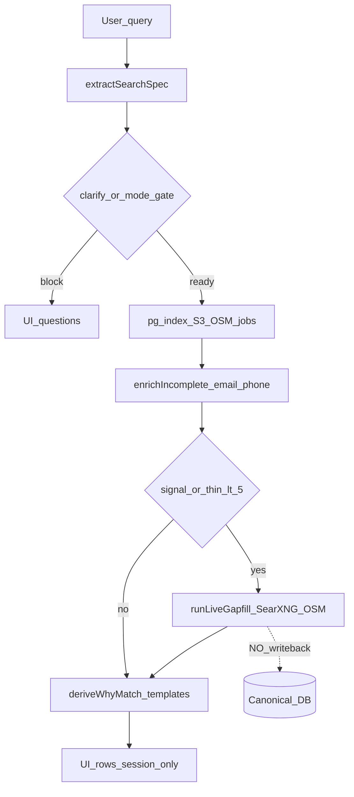

# 09 — Post-implementation reality check

**Date:** 2026-09-14  
**Branch / commit:** `main` @ `9efae83`  
**SearXNG:** `http://127.0.0.1:8888` (HTTP 200; local Docker)  
**Battery baseline:** 43/43 soft-pass, exit 0 ([07-verification.md](07-verification.md))  
**Traces:** [tmp/reality-check-traces.jsonl](../../tmp/reality-check-traces.jsonl) (Tests A–G)  
**Mode:** Audit-only. No CRITICAL gap fixes in this window.

---

## Verdict

**NO — CRITICAL GAPS REMAIN.**

43/43 proves the SPEC_SEARCH path is *reachable* and soft-asserts hold. It does **not** prove universal lead intelligence end-to-end. Tests A–G show false-negative signal parsing, wrong industry binding, directory results sold as “need X”, live SERP cards without DB write-back, templated why-match, no general relevance, and social/Scout **off** the active path.

```
CURRENT SYSTEM
     │
┌────┼────┐
↓    ↓    ↓
COMPLETE  PARTIAL  MISSING
KEEP      IMPROVE  BUILD / INTEGRATE
```

---

## A. Baseline snapshot

| Check | Result |
|-------|--------|
| Git | `main` / `9efae83` — Ship Discover overhaul… |
| `SEARXNG_URL` | `http://127.0.0.1:8888` (dead Render URL removed) |
| SearXNG health | `curl` → 200 + JSON results |
| Battery | 43/43 exit 0 ([07](07-verification.md)) |
| Integrate deferred | [08-integrate-deferred.md](08-integrate-deferred.md) — write-back, Scout, agentic browser deferred |
| Parked | [LATER_WORK.md](../../LATER_WORK.md) — browser-use, embeddings, BullMQ |
| Stale geo claims | [03-geo-matrix.md](03-geo-matrix.md) still says companies/people **live-none** — **outdated** vs live-web (2026-09-14) |

---

## B. Active pipeline (call/import evidence)

Product Discover with `SPEC_SEARCH_ENABLED` default ON ([flag.ts](../../src/lib/search/flag.ts) `useSpecPath`):

```
User (discover.tsx)
  → getSpecFlag / runSpecSearch (server fn)
  → runSpecSearchCore (spec-search.functions.ts)
       → extractSearchSpec
       → clarify / mode-gate / ICP (entity_site, …)
       → coverage selector → pg-index → S3 (fallback)
       → rowSatisfiesSpec + opportunity filters
       → sanitizeSpecRow + completeness split
       → enrichIncompleteRows (email/phone from site)
       → if signal_required OR completeRows < THIN_COMPLETE(5)
            → runLiveGapfill (live-osm | live-web | live-jobs | live-none)
       → applyWhyMatchGate / deriveWhyMatch
       → markSoftDuplicates → page slice → UI
```

**Not on this path:** `searchAllSources` / Reddit / LinkedIn dorks / stealth ([sources.server.ts](../../src/lib/search/sources.server.ts) via legacy [runSearch](../../src/lib/search.functions.ts) only when flag off).



---

## C. Tests A–G (summary)

Full machine traces: `tmp/reality-check-traces.jsonl`. Answers forced `mode=looking` (or selling+offer for A) so mode-gate does not mask retrieval.

| ID | Query | Parsed entity | signal_required | Outcome | DB | Live | Final rows | Persisted |
|----|-------|---------------|-----------------|---------|----|------|------------|-----------|
| **A** | Toronto restaurants needing websites | business | **false** | ICP `entity_site` — **0 rows** | — | not run | 0 | no |
| **B** | people looking for copywriters | person | true | clarify `entity_role` | — | not run | 0 | no |
| **C** | founders needing developers in SF | person | **false** | **25 SF founders** (directory) | pg-index | **not run** | 25 | no |
| **D** | companies needing marketing help in Austin | company | true | hybrid; industry misread as **marketing** | pg-index 0 | **live-web 13** | 13 | **no** |
| **E** | recently funded startups in Berlin | **unknown** | false | clarify entity | — | not run | 0 | no |
| **F** | people asking for website help | person | true | clarify `entity_role` | — | not run | 0 | no |
| **G** | companies hiring copywriters in NY | company | true | DB companies + live ran | pg-index 26 | live-web 11 | 25 (**page = DB YC-style**) | **no** |

### Per-query detail

#### A — Toronto restaurants needing websites
- Spec: `category=restaurants`, `location=Toronto`, **signal=false** (plural `websites` misses `SIGNAL_HINT`; no `opportunity=no_website`).
- With `mode=selling` + `offer=websites` → blocked on **entity_site** ICP; never retrieved.
- **Gap:** “needing websites” ≠ buying signal and ≠ no_website opportunity.

#### B — Copywriting demand
- `looking for` → signal true; entity person; **missing role** → clarify only.
- No social / Reddit demand path on SPEC.

#### C — Founders needing developers
- **signal=false** (`needing developers` plural misses `developer` token).
- Returns directory **founders in SF**, why_match = `founder · in San Francisco`.
- User intent (founders who need developers) **not** represented.

#### D — Companies needing marketing
- signal true; **industry=marketing** extracted from the *help phrase* → filters *marketing companies*, not companies that need marketing.
- Index empty → live-web SERP titles (consultants, job boards, funded lists).
- why_match = `Live web result · {host}` only.
- **persist=false**; keys `live-web:…`.

#### E — Recently funded startups
- Entity **unknown** — “startups” / “funded” not in taxonomy → clarify.
- No funding/news source on SPEC path.

#### F — People asking for web help
- signal true; clarify role; no social monitoring.

#### G — Companies hiring copywriters
- signal true (bare `hiring`); location NY; **no copywriter criterion**.
- Hot-index early-stop 26 companies; live-web also ran (11) but **first page is DB companies** (`Consumer · in New York · public site`).
- Live evidence does not dominate the user-visible page.

---

## D. Live → real leads?

| Stage | Status | Evidence |
|-------|--------|----------|
| live SERP → UI SpecRow | **YES (partial)** | D: 13 `live-web:*` keys in response |
| normalize entity | **WEAK** | title + url + snippet only ([live-gapfill.ts](../../src/lib/search/live-gapfill.ts) `defaultWeb`) |
| enrich | **PARTIAL** | email/phone if domain present; not run as query-aware |
| verify | **WEAK** | `rowSatisfiesSpec` + completeness; no independent verifier |
| **write to DB** | **NO** | grep: no upsert in `spec-search.functions.ts` / `live-gapfill.ts`; 08 defers write-back |

**Confirmed:** `live SERP → UI` exists.  
**Missing:** `live → normalized → enriched → verified → DB`.

---

## E. Enrichment audit

Production path: `enrichIncompleteRows` → `enrichSpecRowFromSite` → `discoverContacts` ([enrich-incomplete.ts](../../src/lib/search/enrich-incomplete.ts)).

| Behavior | Reality |
|----------|---------|
| Fills | email, phone from website crawl |
| Cap / timeout | 8 rows / 12s |
| Query-aware fields | **NONE** (no funding, hiring signal, social proof, “needs X”) |
| Invents contacts | No (harvest only) |

**Mark query-aware enrichment as a gap** — do not claim enrichment “complete.”

---

## F. Intent / relevance / why-match (separated)

| Concept | SPEC path meaning | Proven quality |
|---------|-------------------|----------------|
| **Intent** | `signal_required` + mode/offer/opportunity | Heuristic regex; plurals break A/C; “hiring” alone ≠ copywriter demand |
| **Relevance** | `rowSatisfiesSpec` field filters | **No** general relevance score on Discover SPEC |
| **Why-match** | `deriveWhyMatch` | Prefer existing string; else **templates** (category · location · contact / `Live web result · host`). **Does not** quote SERP excerpt as evidence |

Battery corroboration: `signal-web-dev` whySample = `Consumer · in Chicago · public site` — not “looking for website developers.”

---

## G. Social / Scout on active path?

| Capability | Where it lives | On SPEC_SEARCH? |
|------------|----------------|-----------------|
| Reddit RSS / OAuth fan-out | `sources.server.ts` ← `runSearch` | **NO** |
| LinkedIn / social dorks | legacy `runSearch` filters | **NO** |
| Scout / OpenMagpie / Harken | research docs / 08 deferred | **NO** |
| UI social icons | profile/contact chrome | Display only |

**Major distinction:** social exists in the *legacy* product path, not the *current* Discover SPEC path.

---

## H. Coverage architecture (not global COMPLETE)

```
Country (ISO)
  → coverage-matrix.json source types (hot-index / s3 / OSM / …)
  → adapters: pg-index, S3 parquet, live-osm, live-web (SearXNG), live-jobs
  → tested?: battery soft-pass for sampled geos
  → verified COMPLETE?: NEVER without per-ISO live hit (07 rule #14)
```

**Prohibit** marketing claims of global coverage. [03](03-geo-matrix.md) company/person “live-none” row is stale and must be corrected to “live-web when thin/signal” without claiming COMPLETE.

---

## I. Capability scorecard (refined by A–G)

| Capability | Expectation → **Proven** |
|------------|--------------------------|
| Query extraction | VERIFIED (with critical plural/industry bugs) |
| Clarification | VERIFIED |
| Database retrieval | VERIFIED |
| SearXNG availability | VERIFIED (`127.0.0.1:8888`) |
| Conditional live search | VERIFIED (D, G; battery) |
| DB + live hybrid | VERIFIED path; **quality** PARTIAL (G page = DB) |
| Jobs | VERIFIED (battery / provider-jobs) |
| Basic contact enrichment | VERIFIED |
| Query-aware enrichment | **MISSING** |
| Generic live entity extraction | **WEAK** (SERP cards) |
| Live evidence extraction | **WEAK** |
| Intent | **PARTIAL / buggy** |
| General relevance scoring | **MISSING** |
| Evidence-backed why-match | **MISSING** (templates) |
| Live → DB write-back | **MISSING** |
| Social on active path | **MISSING** |
| Scout integration | **MISSING** |
| Global coverage claim | **FORBIDDEN** |
| Arbitrary industry / role | **PARTIAL / unproven** |
| Agentic browser | **NOT integrated** (LATER_WORK) |
| Deduplication | soft_duplicate VERIFIED; no DB merge |
| Fallbacks | PARTIAL (S3 timeout on D) |
| Final lead quality | **MUST NOT claim ready** |

---

## J. Cost / Free-First Source Audit

**Principle:** No paid provider is mandatory unless free/self-hosted cannot reasonably achieve the capability. Local SearXNG is the **baseline** general-web discovery mechanism; paid SERP is optional emergency fallback only.

### Escalation ladder (target architecture)

```
L0 Existing DB / hot-index / S3
L1 Free structured public data (OSM, registries, Wikidata, Overture)
L2 HTTP fetch
L3 HTML / parser extraction
L4 Sitemap / RSS / JSON-LD / OpenGraph
L5 Playwright / Puppeteer
L6 Agentic browser
L7 Paid API (last resort)
```

### Sources in use or adjacent

| Need | Current SPEC use | Free-first? | Paid mandatory? | Notes |
|------|------------------|-------------|-----------------|-------|
| General web discovery | SearXNG (`live-web`) | **Yes** (self-hosted) | **No** | Keep as default; do not reintroduce dead hosted SearXNG as “required” |
| Business discovery | OSM/Overpass → web fallback | **Yes** | No | Already L1→L2 |
| Company / person thin fill | SearXNG title cards | Partial | No | Needs better extraction (L3–L4), not Serper |
| Jobs | ATS/provider fleet + JobSpy | Mostly free/public | No | Prefer JSON ATS endpoints before browser |
| Contact enrichment | HTTP site harvest | **Yes** | No | Prefer JSON-LD/tel/mailto before browser |
| Social demand | Legacy Reddit etc. only | Possible OSS | No | **Not wired to SPEC** |
| Funding / news | Absent on SPEC | RSS + SearXNG | No | E failed entirely |
| Maps | Nominatim/Overpass | **Yes** | No | |
| Legacy Serper/social APIs | `runSearch` path | — | Convenience only | Must stay optional fallback behind free ladder |

**Audit answer:** Cheapest viable discovery is already largely present (DB → OSM → SearXNG → HTTP enrich). Gaps are **product logic** (signal, intent, why-match, write-back, social-on-SPEC), not “we need a paid SERP core.”

---

## K. Target pipeline (post-fix backlog — do not build yet)

```
USER → UNDERSTAND → ICP/SPEC → SOURCE PLANNER
        → EXISTING DB | FREE SEARCH | PUBLIC DATA
        → ENTITY EXTRACTION → DEDUPE → ENRICH → VERIFY
        → INTENT + RELEVANCE → WHY-MATCH → EVIDENCE-BACKED LEAD
        → USER RESULTS → OPTIONAL WRITE-BACK
```

---

## L. CRITICAL backlog (implementation tickets after 09 acceptance)

Pointer list only — **binding rules, schemas, tests, and prohibitions live in §L1.**

1. **Signal / opportunity parsing** — semantic entity-vs-need model (not token plurals alone); map “needing websites” → opportunity/signal; never bind help-noun as `entity_industry` (D). → L1.1–1.2, Tests 1–2
2. **Intent ≠ directory** — hard qualification gate when `signal_required` (C, G). → L1.3, Test 3
3. **Evidence-backed why-match** — evidence schema; no evidence → no evidence-backed why-match. → L1.4, Tests 4–5
4. **Live → DB write-back** — discovered→…→persisted lifecycle; verified-only. → L1.5, Test 6
5. **Query-aware enrichment** — by query type (not “one extra field”). → L1.6
6. **Social-signal interface on SPEC** — provider-agnostic; ≥1 real provider E2E; Scout/Harken optional. → L1.7, Test 7
7. **Funding / startup as event/signal query** — not directory-only; E must not die at unknown. → L1.8, Test 8
8. **Relevance score** — separate from intent and why-match. → L1.9, Test 9
9. **Refresh 03 geo matrix** — remove false live-none for company/person (docs only).
10. **Free-first enforcement** — paid SERP never required; ladder + logging. → L1.10, Test 10

---

## L1. CRITICAL IMPLEMENTATION CONTRACT — MUST SATISFY BEFORE PHASE 1 PASS

This section turns §L from a backlog into a **build contract**. The audit evidence above stays authoritative for *what is broken*; this section is authoritative for *what must be built*, *what is forbidden*, and *how pass/fail is decided*.

**Phase 1 DONE** means: all hard invariants below hold; Tests 1–10 pass as written (provider-level capabilities are mandatory — see L1.7 / Test 7); individual requests may fail-closed with an explicit unsupported label when a *specific* source/query is unavailable — never silent fake; prohibitions not violated; A–G re-run does not regress into the failure modes recorded in this document. **Passing the existing 43/43 battery alone is not Phase 1 DONE.**

**Cross-cutting invariant — field provenance:** Every externally discovered field (identity, need, opportunity, signal, enrichment) SHOULD be traceable to provenance metadata. Prefer attaching per-field provenance of the form:

```yaml
field: string                 # e.g. entity_industry, funding_round, email
value: any
source: string                # provider/adapter name
source_type: enum             # web | osm | job | social | news | registry | db | other
source_url: string | null
observed_at: iso8601
extraction_method: string     # e.g. json_ld | html_parse | searxng_title | osm_tags | ats_json
confidence: number            # 0..1
verification_status: enum     # discovered | normalized | verified | rejected
```

Bare values with no way to answer “where did this come from?” fail the anti-hallucination requirement for VERIFIED / PERSISTED leads.

### L1.0 Phase 1 build order (mandatory sequence)

Do not skip ahead. Social/funding sit on top of a correct lead model.

```
PHASE 1A — Request semantics
  signal / opportunity
  entity vs need
  intent fields (not directory contamination)

        ↓

PHASE 1B — Evidence
  evidence schema
  live extraction into evidence[]
  evidence-backed why-match

        ↓

PHASE 1C — Qualification
  relevance_score (request/entity fit)
  intent (seeking/considering)
  directory contamination gate

        ↓

PHASE 1D — Live lead lifecycle
  DISCOVERED → NORMALIZED → DEDUPLICATED
  → ENRICHED → VERIFIED → PERSISTED

        ↓

PHASE 1E — Source expansion
  social-signal interface + ≥1 provider
  funding/startup event discovery

        ↓

PHASE 1F — Free-first enforcement
  SearXNG / public / open sources first
  browser → agentic → paid last resort
  provider_used / fallback_reason / cost_class logs

        ↓

PHASE 1G — Regression
  A–G replay
  semantic battery (Tests 1–10)
  persistence + anti-hallucination tests
```

---

### L1.1 Semantic request model (entity ≠ need ≠ signal ≠ intent ≠ relevance)

The extractor / spec layer MUST distinguish these fields. Names may map to existing `SearchSpec.criteria` keys, but **concepts must not collapse**.

| Field group | Fields (conceptual) | Meaning |
|-------------|---------------------|---------|
| **Entity identity** | `entity_type`, `entity_industry`, `entity_role`, `entity_location` | What the entity *is* |
| **Requested need** | `requested_service`, `requested_role`, `requested_product` | What the *user* wants to find entities that need/offer |
| **Opportunity** | `opportunity` (e.g. `no_website`, `stale_site`, `hiring_gap`) | Structural gap that can exist without live “asking” proof |
| **Signal** | `signal` / `signal_required` + typed signal | Evidence that a need/event is *expressed* somewhere |
| **Intent** | intent score or structured intent | Evidence the entity is currently seeking/considering |
| **Relevance** | `relevance_score` | How well the entity matches the *request* (not buying intensity) |
| **Evidence** | `evidence[]` | Observed facts backing signal/opportunity/intent/why |

**Hard rule — semantic direction (fixes D):**

> Never set `entity_industry` (or equivalent identity industry) merely because the query contains “needs / needing / looking for / hiring / marketing / SEO / website / developers …”. Those tokens bind to **requested_*** / **opportunity** / **signal**, not to what the company *is*.

Example:

- Query: `companies needing marketing help in Austin`
- Allowed: `entity_type=company`, `entity_location=Austin`, `requested_service=marketing`, `signal_required=true`
- Forbidden: `entity_industry=marketing` derived from that phrase

**Hard rule — plurals are not the fix:**

> Solving “needing websites” / “needing developers” / “needing marketers” by only adding isolated regex plurals (`website`→`websites`, `developer`→`developers`) is **insufficient** and does **not** satisfy Phase 1A. Stem/lemma/phrase grammar or an explicit need-phrase parser is required so identity and need stay separated.

---

### L1.2 Opportunity / signal mapping (examples from A–G)

| User phrasing | Must produce (at least) | Must not produce |
|---------------|-------------------------|------------------|
| restaurants needing websites | business + category restaurants + (`opportunity=no_website` and/or signal need=website) | silent directory-only with `signal=false` and no opportunity |
| founders needing developers | person/founder + `requested_role=developer` (or service) + signal/opportunity | directory founders with no need evidence (C failure) |
| companies needing marketing | company + `requested_service=marketing` + signal | `entity_industry=marketing` |
| people looking for copywriters | person demand / signal + role/service copywriter | clarify forever with no path to demand sources |
| companies hiring copywriters | company + hiring signal + `requested_role=copywriter` | NY company directory with template why (G failure) |
| recently funded startups | startup/company + funding **event** fields + evidence | `entity=unknown` dead-end with no funding path (E) |

---

### L1.3 Directory contamination invariant (intent ≠ directory)

**Hard invariant:**

```
IF signal_required = true
AND row has no signal evidence
AND row has no opportunity evidence
AND row has no intent evidence
THEN
  row MUST NOT be classified as a qualified lead
```

Allowed dispositions for such a row:

- **drop** from the default result set, or
- surface only under an explicit label: `potential_match` — *no verified signal* (never the default “qualified” grid)

**Default:** unsupported directory matches are **not** shown as qualified leads.

Re-ranking alone without this gate does **not** satisfy the ticket. This directly addresses C and G.

---

### L1.4 Evidence schema and why-match

Every qualified signal lead MUST carry `evidence[]` with objects shaped at least as:

```yaml
evidence:
  source_url: string          # required for qualified signal leads (and for structural opportunity — see below)
  source_type: enum           # web | osm | job | social | news | registry | db | other
  excerpt: string | null      # observed text; null only when opportunity is structural AND provenance below is present
  observed_at: iso8601        # when we observed it
  evidence_type: enum         # hiring | service_request | no_website | funding | social_ask | contact | other
  supports: enum              # requested_role | requested_service | opportunity | intent | identity | other
  confidence: number          # 0..1
```

Example (hiring):

```yaml
evidence_type: hiring
source_url: https://…
excerpt: "We're hiring a copywriter…"
supports: requested_role
observed_at: 2026-09-14T…
```

**Structural opportunity provenance (Test 4 / `no_website` etc.):**

Structural opportunity evidence MUST identify the **observation and source used** to establish the structural condition.

- Example of a legitimate `opportunity=no_website`: the system checked an authoritative/appropriate website-presence source (e.g. OSM `website`/`contact:website` tags empty after a successful place match; company registry / directory row with explicit null website; HTTP probe of a known domain that 404s/NXDOMAIN with logged method) and records that check as evidence (`source_url` or source id, `source_type`, `observed_at`, `evidence_type=no_website`, method).
- **Hard rule:** Absence MUST NEVER be inferred merely because a search returned nothing.

  Forbidden false-positive path:

  ```
  couldn't find website in SERP
    → no website
    → opportunity=no_website
  ```

**Hard invariant:**

> **No evidence → no evidence-backed why-match.**

`why_match` MUST be generated from `evidence[]` (and/or a declared opportunity with structural provenance as above). It MUST NOT be independently invented, and MUST NOT treat host-only strings as proof.

**Forbidden why-match (current failure modes):**

- `Live web result · {host}`
- `Consumer · in Chicago · public site`
- `founder · in San Francisco` when the query was “needing developers”

**Required shape:** human-readable explanation that cites what was observed (role/service/opportunity + source).

---

### L1.5 Live → DB lifecycle (what “verified” means)

```
DISCOVERED
    ↓
NORMALIZED
    ↓
DEDUPLICATED
    ↓
ENRICHED
    ↓
VERIFIED
    ↓
PERSISTED
```

| Stage | Meaning |
|-------|---------|
| DISCOVERED | Raw hit from SearXNG/OSM/jobs/social/etc. |
| NORMALIZED | Identifiable entity fields + canonical URL/domain where applicable |
| DEDUPLICATED | Merged against existing DB / in-batch keys |
| ENRICHED | Query-aware fields applicable to the request (L1.6) |
| VERIFIED | See **hard definition of VERIFIED** below |
| PERSISTED | Written with provenance, evidence, verification status, timestamps, confidence |

**Hard definition — VERIFIED:**

> **VERIFIED** means the system has **independently established (1) the entity identity and (2) the specific claim required by the query** from one or more **permitted sources**, with **provenance**. A search-result **title/snippet alone cannot establish verification.**

Therefore the following is **not** VERIFIED (and MUST NOT set `verified=true` / persist as verified):

```
if name && url:
    verified = true   # FORBIDDEN shortcut
```

Minimum for VERIFIED on a signal/opportunity query:

1. Entity identity confirmed beyond SERP title (e.g. resolvable canonical domain/page, registry/OSM id, or ATS job posting identity) with provenance.
2. The query’s claim (hiring / need / funding / structural opportunity / etc.) backed by `evidence[]` that meets L1.4 (including structural opportunity rules).
3. No unsupported inferred intent.

**Never persist:**

- SERP title alone
- Search snippet alone if entity cannot be identified
- Unverified social result
- Duplicate of an existing entity (without merge)
- Unsupported inferred intent
- Fabricated evidence
- Rows that only satisfy “has name + url”

**May persist:**

- Identifiable entity
- Canonical URL/domain where applicable
- Source provenance (entity-level and preferably per-field)
- `evidence[]`
- Verification status
- Timestamps + confidence
- Normalized entity fields

Today’s stop at **live SERP → UI** is explicitly insufficient (see §D).

---

### L1.6 Query-aware enrichment (by query type)

Contact harvest (email/phone) remains allowed but **does not** satisfy this ticket.

The table below lists **acceptance exemplars**, not an exhaustive supported-query enum. **Implementation must derive enrichment requirements from the semantic request model (L1.1) and MUST NOT hard-code Phase 1 support to only these examples.**

| Query class (exemplar) | Required enrichment (minimum) |
|------------------------|-------------------------------|
| companies hiring copywriters | job/hiring evidence |
| startups recently funded | funding round and/or date + source |
| businesses needing websites | website presence assessment + need/opportunity evidence (with structural provenance if no_website) |
| founders needing developers | founder identity + need evidence |
| people looking for copywriters | person identity + demand evidence |
| companies needing marketing | company identity + marketing-need evidence |

Acceptance is against **query semantics** derived from the request model, not against “we added one field somewhere” or “we special-cased six strings.”

---

### L1.7 Social-signal contract (SPEC path)

**Required capability (not three named products):**

```
SPEC
 → signal_required
 → signal source planner
 → social sources when appropriate
 → structured social signal
 → entity resolution
 → evidence[]
 → lead
```

**Provider-mandatory vs request-level unsupported:**

- **Provider capability MUST exist in Phase 1E:** at least one real social provider must be wired on the SPEC path and must execute end-to-end (discovery → signal extraction → entity resolution → evidence → lead) for a demonstrable query in Test 7.
- **Individual request/source may fail closed:** if that provider fails for a *particular* query or upstream source (rate limit, empty subreddit, blocked host), that request may return honest unsupported / empty — that is allowed.
- **Forbidden:** treating “honest unsupported” as Phase 1 completion for the social *capability* itself (i.e. shipping no working provider and marking Test 7 pass via unsupported).

Additional rules:

- Implement a **provider-agnostic** social-signal interface on the SPEC path.
- Scout / OpenMagpie / Harken may be used as implementations or references; **none is individually mandatory**.
- Claiming “social works” because legacy `runSearch` / `sources.server.ts` contains Reddit code is **forbidden** (see prohibitions).
- Directory rows MUST NOT be returned as a substitute for missing social demand.

---

### L1.8 Funding / startup contract

`recently funded startups in Berlin` is a **signal/event query**, not a bare startup-directory query.

Conceptual fields (map as needed):

- `startup` / company identity
- `funding_status`, `funding_round`, `funding_amount`, `funding_date`
- `investors` (optional)
- `source` + `evidence[]`

Phase 1E must produce funding/startup **evidence** (or an honest empty from a funding-capable planner that ran), not terminate at `entity=unknown` with no path. Same distinction as social: the **planner/capability** is mandatory; a thin geo with zero funding hits may fail closed for that request.

---

### L1.9 Relevance vs intent vs why-match

| Concept | Definition | Example |
|---------|------------|---------|
| `relevance_score` | Request ↔ entity fit | Toronto restaurant for “Toronto restaurants needing websites” → high relevance even if intent unknown |
| intent | Evidence of seeking/considering | High only with signal/opportunity evidence |
| `why_match` | Explanation **from evidence** | Must cite observed hiring/need/funding text or proven opportunity |

A row may be `relevance=0.96` and `intent=0.10` — highly on-topic, weak seeking proof. That is valid **potential_match**, not a fake qualified signal lead.

Qualified Phase 1 output for signal queries MUST expose **separate** `relevance`, intent (score or structured), and `why_match`.

---

### L1.10 Free-first implementation rule

**Hard rule:** The implementation MUST NOT introduce a paid SERP provider as a **required** dependency.

**Hard rule — no parallel paid SERP:** A paid SERP provider MUST NOT be invoked when SearXNG/free discovery succeeds sufficiently for the requested operation. Parallel “for better results” paid calls while free tiers already suffice are forbidden.

Mandatory escalation:

```
free/self-hosted source (SearXNG, OSM, registries, DB, RSS, …)
      ↓ fails
free alternate source
      ↓ fails
browser extraction (Playwright/etc.)
      ↓ fails
agentic browser
      ↓ fails
paid API (optional emergency only)
```

Every external fetch path that can escalate MUST log:

- `provider_used`
- `fallback_reason` — when `cost_class=paid`, MUST record the **exact reason cheaper tiers were insufficient**
- `cost_class` (`free` | `self_hosted` | `browser` | `paid`)

Local SearXNG (`SEARXNG_URL=http://127.0.0.1:8888`) remains the baseline general-web mechanism (§J).

---

### L1.11 Phase 1 acceptance tests (all required)

Phase 1 cannot be declared complete until these pass.

| # | Name | Requirement |
|---|------|-------------|
| **1** | Plural signals | `restaurants needing websites`, `founders needing developers`, `companies needing marketers`, `people looking for copywriters` — pluralization must not destroy signal/opportunity detection |
| **2** | Semantic direction | `companies needing marketing` MUST NOT set identity industry = marketing |
| **3** | Directory contamination | `signal_required=true` + row with no signal/opportunity/intent evidence → not a qualified lead |
| **4** | Evidence | Every qualified signal lead has URL + excerpt/evidence **or** structural opportunity with provenance (L1.4) + `evidence_type` + timestamp. SERP-empty ≠ no_website |
| **5** | Why-match | References actual evidence; not host-only or bare directory templates |
| **6** | Live persistence | A genuinely discovered live entity reaches **VERIFIED** (L1.5 hard definition) then DB then retrieve again — not merely name+url |
| **7** | Social | ≥1 real social provider **capability** executes E2E on SPEC (discovery → signal → entity → evidence → lead). Per-query unsupported allowed only after the provider ran and failed for that request — not as a substitute for shipping the provider |
| **8** | Funding | `recently funded startups in Berlin` yields startup/funding evidence path — not unknown→clarify with no planner |
| **9** | Relevance | Qualified output contains separate relevance, intent, why_match |
| **10** | Free-first | Prove SearXNG/free source used for a web-discovery query; paid SERP not required; paid SERP **not invoked** when free discovery already succeeds sufficiently; if paid is used, `fallback_reason` states why cheaper tiers were insufficient |

Also re-run A–G (`scripts/reality-check-traces.mts`) and record that prior failure modes (A signal false / site block without opportunity; C directory founders; D industry=marketing; E unknown; G directory page) are fixed or explicitly labeled per invariants.

---

### L1.12 Phase 1 implementation prohibitions (DO NOT CHEAT)

The implementing agent **MUST NOT**:

1. Solve pluralization only by adding isolated regex tokens.
2. Treat directory presence as evidence of intent.
3. Treat a SERP title/snippet as verified entity identity without validation.
4. Generate evidence that was not actually observed.
5. Generate why-match text unsupported by evidence.
6. Treat email/phone enrichment as query-aware enrichment.
7. Make a paid SERP API a required dependency.
8. Invoke a paid SERP provider when SearXNG/free discovery already succeeds sufficiently (including “parallel for quality”).
9. Claim social monitoring merely because a legacy path contains social code.
10. Pass Test 7 by returning only “unsupported” without a working social provider on SPEC.
11. Infer `opportunity=no_website` (or similar) solely because search returned no website URL.
12. Hard-code query-aware enrichment to only the six exemplar query strings.
13. Claim global coverage from sampled countries.
14. Mark Phase 1 complete because the existing 43/43 battery still passes.
15. Delete or weaken existing tests to make new tests pass.
16. Replace failed behavior with hardcoded answers for the acceptance queries.
17. Silently downgrade unsupported leads into qualified leads.
18. Set `verified=true` from name+url alone.
19. Integrate Scout/OpenMagpie/Harken merely for the sake of integration; first satisfy the capability contract (L1.7).
20. Persist fields with no provenance when claiming VERIFIED/PERSISTED.

---

### L1.13 Definition of Phase 1 DONE

Phase 1 is DONE only when **all** of the following are true:

1. Phases 1A–1G completed in order.
2. Hard invariants in L1.1, L1.3, L1.4 (including structural opportunity), L1.5 (VERIFIED definition), L1.10 (including no parallel paid SERP) hold in code (not only in docs).
3. Acceptance Tests 1–10 pass with recorded traces — including mandatory social **provider** capability (Test 7) and free-first non-invocation of paid SERP when free suffices (Test 10).
4. A–G failure modes from this audit are closed or fail-closed honestly at the **request** level.
5. No prohibition in L1.12 was used as a shortcut.
6. Docs: `03` live-none stale claim already corrected; `05`/`07` updated with Phase 1 verification ids when tests land.

Until then: verdict remains **NO — CRITICAL GAPS REMAIN**.

---

## M. HIGH / MEDIUM (after CRITICAL)

- Hybrid page ordering so live evidence isn’t buried under DB early-stop (G).
- S3 tier timeout honesty (D).
- Soft-dup → hard merge policy.
- Agentic browser only after L5 fails thin geos (LATER_WORK).
- Scout/OpenMagpie as optional patterns, not requirements.

---

## N. What is COMPLETE (keep)

- Spec extract + clarifier + mode gate (with known bugs above).
- DB/index/S3 retrieval for directory hunts.
- Conditional live SearXNG/OSM/jobs when thin or signal.
- Contact harvest enrichment.
- Soft dedupe flag.
- Jobs provider path.
- Battery soft-pass harness.

---

## O. What is PARTIAL (improve)

- Hybrid quality and ordering.
- Why-match templates.
- Intent regex coverage.
- Live entity quality (SERP cards).
- Fallbacks / timeouts.

---

## P. What is MISSING (build/integrate later)

- Live write-back.
- Query-aware enrich.
- Evidence-backed why-match.
- General relevance.
- Social on SPEC.
- Scout clone.
- Funding discovery.
- Agentic browser integration.
- Global COMPLETE claims.

---

## Q. Explicit non-claims

This audit does **not** claim:

- Universal industry/role coverage.
- Global geo COMPLETE.
- Social monitoring in production Discover.
- Paid SERP necessity.
- That 43/43 = product complete.

---

## R. Next phases (after acceptance)

**Phase 1** follows §L1 build order only:

1A Request semantics → 1B Evidence → 1C Qualification → 1D Live lifecycle → 1E Source expansion (social + funding) → 1F Free-first → 1G Regression (A–G + Tests 1–10)

Then:

2. Fix HIGH → verify  
3. Medium → verify  
4. Full regression battery  
5. Integrate last (08 re-entry)  

Do **not** start Scout productization, global COMPLETE claims, or out-of-order Phase 1E work until 1A–1D invariants hold. Hand the coding agent **§L1** (including VERIFIED definition, structural opportunity provenance, provider-vs-request unsupported, no parallel paid SERP, semantic/dynamic enrichment, field provenance), not §L alone. **Do not start Phase 1 code until the user explicitly asks to execute.**

---

## S. Phase 1 execution log (2026-09-14)

User ordered **execute Phase 1**. Landed in order 1A→1G:

| Step | Module(s) | Notes |
|------|-----------|-------|
| 1A | `need-phrase.ts`, `search-spec-extract.ts`, `search-spec.ts` | Entity ≠ need; plurals; funding→company; industry suppressed in need spans |
| 1B | `evidence.ts`, `live-gapfill.ts` | Evidence schema; why_match from evidence under signal |
| 1C | `qualify.ts` | Directory contamination gate; relevance vs intent |
| 1D | `persist-live.server.ts` | VERIFIED stamp; upsert idx_* (not name+url alone) |
| 1E | `social-signal.ts` | Reddit public provider on SPEC; funding criteria |
| 1F | `provider-ladder.ts`, `serp-providers.server.ts` | Free-first log; skip paid when free ≥3 |
| 1G | `phase1-acceptance.test.ts` + `05`/`07` updates | Tests 1–10 **PASS** |

**Unit verdict:** Tests 1–10 pass. **Phase 1 DONE** still requires A–G live replay (`scripts/reality-check-traces.mts`) confirming prior failure modes closed — do not equate unit PASS with L1.13 DONE without that replay.

### A–G live replay (same day, post-fix)

| ID | Prior failure | Replay result |
|----|---------------|---------------|
| A | `signal=false`; blocked site | `signal=true`, `opportunity=no_website`, live-osm, 3 qualified rows |
| B | clarify / no social | `signal=true`, person, live-web 1 row; Reddit provider ran → HTTP 403 (request fail-closed) |
| C | 25 SF founders directory | gate kept **1** evidence-backed row (not directory dump) |
| D | `industry=marketing` | **no** industry criterion; `requested_service=marketing`; 0 qualified (honest empty) |
| E | `entity=unknown` | `entity=company` + `funding_status=recent`; 15 live rows |
| F | clarify | `signal=true`; 0 qualified (honest empty after gate) |
| G | page = DB companies | 3 live-qualified rows; directory without evidence dropped |

Persist: path wired; this host had `DATABASE_URL` unset → skipped (logged). Reddit 403 = request-level unsupported after provider execution (L1.7 allowed). Free-first: `[provider-ladder] searxng` / `self_hosted` on live-web paths.

### A–G persist replay (same day, post DATABASE_URL note)

`pg` was never a dependency; `DATABASE_URL` unset. Persist now defaults to **My Supabase service-role upsert** into `idx_*` (same store as indexed reads). Optional `DATABASE_URL`+`pg` remains a fallback.

Re-run: `AWAIT_PERSIST_LIVE=1 npx tsx --env-file=.env scripts/reality-check-traces.mts`

| ID | Persist | Round-trip |
|----|--------:|-----------:|
| A | 0 (OSM/no VERIFIED claim keys) | 0 |
| B | 0 (0 qualified rows) | 0 |
| C | **1** `@supabase` | 1 |
| D | 0 (honest empty after gate) | 0 |
| E | **15** `@supabase` | 5 (sampled) |
| F | **1** `@supabase` | 1 |
| G | **4** `@supabase` | 4 |

Live → DB write-back **exercised** on C/E/F/G. To use raw `DATABASE_URL`, paste the Supabase DB password into `.env` (host `db.fxcrmybvfokyrvcuhcgh.supabase.co`) and `npm i pg`.

---

## Appendix — Proximate battery evidence (not A–G)

| Battery id | Engines | Note |
|------------|---------|------|
| d2c-reykjavik | pg-index, s3, live-web | Hybrid + live host why |
| b2b-pune | pg-index, live-web | Hybrid |
| signal-web-dev | pg-index, live-web | signal true; why = directory templates |
| signal-local | pg-index, live-osm | SEO ask → OSM phones, not SEO evidence |
| sell-websites | — | entity_site clarify (same class as A) |

---

*End of 09. Artifacts: this file + `tmp/reality-check-traces.jsonl` + `scripts/reality-check-traces.mts`. Binding Phase 1 build contract: **§L1**.*
